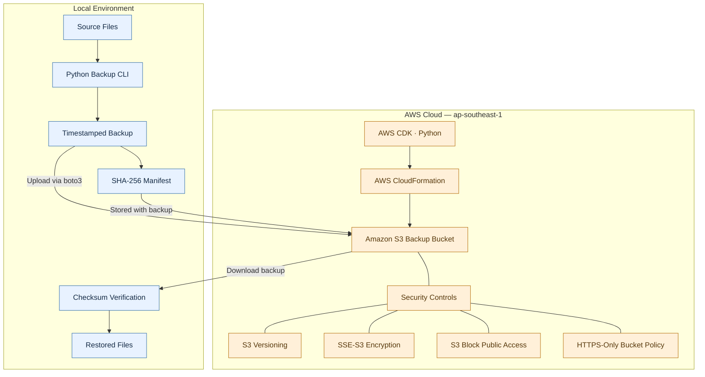

# AWS Backup & Recovery Lab

A Python-based backup and recovery utility using **Amazon S3, AWS CDK, and SHA-256 integrity verification**. This project demonstrates how to provision secure AWS storage with Infrastructure as Code, upload backups to the cloud, and recover files while detecting corruption.

Built as a hands-on portfolio project focused on practical AWS Cloud Engineering skills.

## AWS Architecture



## AWS Services & Cloud Engineering Skills

| AWS service / technology | Implementation | Cloud engineering relevance |
|---|---|---|
| **Amazon S3** | Stores timestamped backups and checksum manifests | Cloud storage, object management and recovery |
| **AWS CDK (Python)** | Defines the backup bucket as code | Infrastructure as Code and repeatable provisioning |
| **AWS CloudFormation** | Deploys the CDK-generated infrastructure | Stack-based infrastructure lifecycle management |
| **S3 Versioning** | Enabled on the backup bucket | Recovery options for previous object versions |
| **S3 Server-Side Encryption** | SSE-S3 using AES-256 | Data protection at rest |
| **S3 Block Public Access** | All four public-access controls enabled | Secure-by-default storage configuration |
| **S3 Bucket Policy** | Denies requests using insecure transport | Enforces HTTPS for bucket access |
| **AWS IAM / CLI credentials** | Uses the configured AWS profile for access | Credential-based access to AWS resources |

### Python & Reliability Engineering

- Automated, timestamped local backups.
- SHA-256 checksums recorded in a JSON manifest.
- S3 upload and download through `boto3`.
- Checksum verification before restoring files.
- Rejection of corrupted backups and unsafe manifest paths.
- Automated tests for local recovery, upload behavior, download behavior, and failure cases.

## Recovery Workflow

1. **Create a backup:** Copy source files into a timestamped directory and generate a SHA-256 manifest.
2. **Upload to S3:** Store the files and manifest under a dedicated backup prefix.
3. **Download a backup:** Retrieve the selected backup into a separate local directory.
4. **Verify integrity:** Compare the downloaded files against the expected SHA-256 hashes.
5. **Restore:** Copy files into the recovery destination only after all backup files pass verification.

The recovery process was tested end to end against a deployed S3 bucket. The downloaded backup was restored successfully, and a directory comparison found no differences from the original sample data.

## Technology Stack

- Python
- `boto3`
- AWS CDK for Python
- AWS CloudFormation
- Amazon S3
- `pytest`
- SHA-256 integrity verification
- AWS CLI

## Getting Started

### Prerequisites

- Python 3.10 or later
- Node.js and npm
- AWS CLI configured with an AWS profile
- AWS CDK CLI
- An AWS account with the necessary IAM permissions

### 1. Clone the repository

```bash
git clone https://github.com/aimanhaizal/aws-backup-recovery-lab.git
cd aws-backup-recovery-lab
```

### 2. Set up the Python environment

```bash
python3 -m venv .venv
source .venv/bin/activate

python -m pip install -r requirements.txt
```

### 3. Configure AWS credentials

Use an existing AWS CLI profile with the permissions required for the project.

```bash
export AWS_PROFILE=portfolio-dev
export AWS_REGION=ap-southeast-1
```

Do not commit credentials, access keys, or local AWS configuration files to the repository.

### 4. Review and deploy the infrastructure

Inspect the synthesized CloudFormation template:

```bash
cdk synth
```

Review the proposed infrastructure changes:

```bash
cdk diff
```

Deploy the stack after reviewing the changes:

```bash
cdk deploy
```

The stack creates a dedicated S3 bucket with versioning, encryption, public-access blocking, HTTPS enforcement, and a retention policy.

**Important:** The bucket uses a retain policy. Deleting the CloudFormation stack does not automatically delete the bucket or its stored objects. Review AWS resources and costs before deploying or cleaning up.

### 5. Identify the backup bucket

```bash
aws cloudformation describe-stack-resources \
  --stack-name AwsBackupRecoveryLabStack \
  --query "StackResources[?ResourceType=='AWS::S3::Bucket'].PhysicalResourceId" \
  --output text \
  --profile "$AWS_PROFILE" \
  --region "$AWS_REGION"
```

Use the returned bucket name in the following commands.

### 6. Create sample data

The demo files are generated locally and are excluded from Git.

```bash
mkdir -p demo-data
printf 'id,value\n1,alpha\n2,beta\n' > demo-data/records.csv
printf 'Recovery test\n' > demo-data/notes.txt
```

### 7. Create and upload a backup

Create a timestamped local backup:

```bash
python -m src.backup_recovery.cli backup \
  --source demo-data \
  --destination local-backups
```

Copy the backup path printed by the command and upload it:

```bash
python -m src.backup_recovery.cli upload \
  --backup "PASTE_BACKUP_PATH_HERE" \
  --bucket YOUR_BUCKET_NAME
```

### 8. Download and restore

Use the backup ID from the timestamped directory name:

```bash
python -m src.backup_recovery.cli download \
  --bucket YOUR_BUCKET_NAME \
  --backup-id YOUR_BACKUP_ID \
  --destination s3-recovery-test
```

Restore the downloaded backup into a separate directory:

```bash
python -m src.backup_recovery.cli restore \
  --backup "s3-recovery-test/YOUR_BACKUP_ID" \
  --destination s3-restored-data
```

Compare the original and recovered files:

```bash
diff -r demo-data s3-restored-data
```

No output from `diff` indicates that the directories match.

## Testing

Run the automated test suite:

```bash
python -m pytest -q
```

The current test suite contains **9 passing tests** covering local backup and restore behavior, checksum validation, unsafe manifest paths, S3 upload and download behavior, and missing-backup handling.

The S3 unit tests use mocks, so they do not need to upload files to AWS. The end-to-end recovery demonstration was separately tested against the deployed S3 bucket.

## Security & Cost Considerations

- S3 Block Public Access is enabled.
- S3 server-side encryption uses SSE-S3.
- A bucket policy denies requests that use insecure transport.
- S3 Versioning is enabled to retain previous object versions.
- The bucket has a retention policy to reduce the risk of accidental deletion through stack removal.
- AWS credentials are supplied through the configured profile rather than stored in source code.
- No EC2 instances, NAT gateways, load balancers, or databases are provisioned by this project.

**Cost note:** This project uses a small S3 footprint, but AWS usage is not guaranteed to be free. Storage, requests, retained object versions, and other applicable charges may apply. Check current pricing and your account's billing information, and remove unneeded objects when finished. Because the bucket is retained by CloudFormation, stack deletion alone will not remove its contents.

For deployment cost considerations and safe resource cleanup, see
[Cost & Cleanup Guide](docs/COST_AND_CLEANUP.md).

## Current Scope & Future Improvements

This implementation focuses on a small, manually initiated backup and recovery workflow.

Potential future improvements include:

- Scheduled backups and automated retention management.
- Cross-region backup replication and disaster recovery.
- More comprehensive S3 integration and failure-handling tests.
- Recovery reporting and operational metrics.
- CI automation for tests and infrastructure validation.

These are future enhancements, not capabilities claimed by the current implementation.

## Portfolio Relevance

This project demonstrates practical experience with AWS storage, secure resource configuration, Infrastructure as Code, Python automation, cloud SDK integration, and integrity-verified recovery.

It complements cloud operations work involving Linux, EC2, monitoring, and operational troubleshooting by demonstrating a separate **backup and recovery** capability.


## License

MIT License.